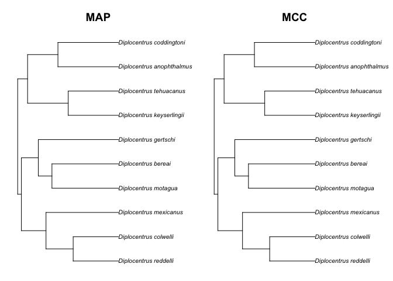
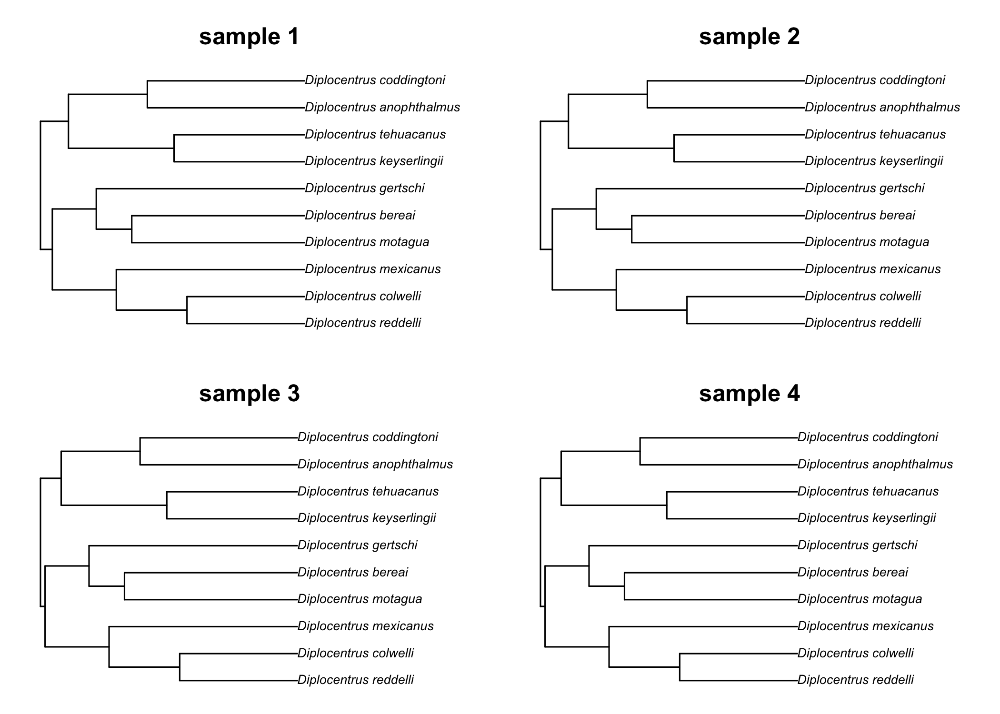
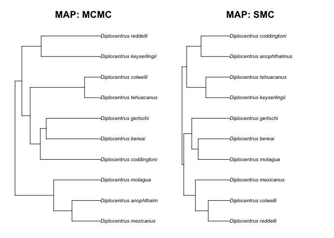
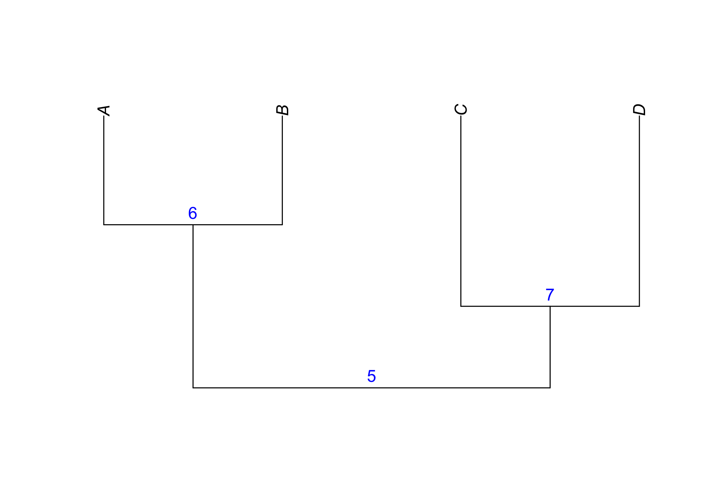

* TOC
{:toc}

Source:
[treepplr-example.qmd](https://github.com/foersterst/foersterst.github.io/blob/master/pages/code/treepplr-example.qmd)

This vignette covers:

1.  [Diversification models (CRBD)](#diversification-models-crbd)
2.  [Tree inference (pruning)](#tree-inference-pruning)
3.  [Host-repertoire (flat root prior)](#host-repertoire-subroot)
4.  [Qualitative trait evolution](#qualitative-trait-evolution)

> Make sure you’re using treepplr from my branch `improvements`.

I’ve been reworking treepplr to make it faster, easier to use, and less
redundant. Along the way I reorganized the code so it’s easier to
maintain, and fixed a few bugs. This vignette shows how to convert R
objects (lists, data frames, phylo objects, etc.) into TreePPL input
files, and how to convert TreePPL output back into R. I’ll explain the
new and updated functions as they come up.

The core workflow in treepplr is:

**R objects** → `tp_data()` + `tp_sampler()` → `tp_run()` → **R
objects**

``` r
library(devtools)
library(ape)

load_all()
```

## Diversification models (CRBD)

CRBD, ClaDS2, and BDD2 models are all fitted the same way, so I’ll use
CRBD as the example here. I’ll use a tree of the scorpion genus
*Centruroides*, which is included in the version of treepplr on my
`improvements` branch:

``` r
# read in the tree
data("centruroides")

# tree height
max(node.depth.edgelength(centruroides))
```

    [1] 59.23941

``` r
class(centruroides)
```

    [1] "phylo"

To prepare the data for TreePPL, we need to create a named list with the
input items required by the CRBD model. Each element of the list must be
named exactly like an argument of the model; the order doesn’t matter.
To see the exact names, we use the function `tp_expected_input()`:

``` r
tp_expected_input(tppl = "crbd")
```

    ── Expected Input ──

    Model file:
    '/tmp/treeppl-0.4/6yjjihgyj569rg7bw7jkqxy3z1-treeppl-0.4/lib/mcore/treeppl/models/diversification/crbd.tppl'

    Model name: crbd

    Expected arguments:

    • tree (tpPhylo)

    • rho (numeric)

From the output above we see that the CRBD model expects two arguments:
`tree` and `rho`, and these are the names we have to provide to the
items in our list. `rho` is a numeric object and `tree` is a tpPhylo
object, which is specific to treepplr. We create the tpPhylo object from
an `ape::phylo` object using `tp_phylo_to_tpPhylo()`:

``` r
phy <- tp_phylo_to_tpPhylo(phy = centruroides)

# tpPhylo objects have a printing method similar to ape::phylo:
phy
```

    Phylogenetic tree of class <tpPhylo>, with 58 tips and 57 internal nodes.

    Rooted; includes branch lengths; root age = 59.2394

> We’ll see later that some models require trees with extra information
> at the leaves and internal nodes. Function `tp_phylo_to_tpPhylo()`
> allows such trees to be created by using the arguments `leaf_extra`
> and `node_extra`. If needed, it is also possible to change the labels
> for node and leaf constructors using the arguments `node_ctor` and
> `leaf_ctor`, respectively.

Now, we create our named list with the data required by our model:

``` r
L <- list(tree = phy, rho = 0.55)
```

Next, we call `tp_data()` to build the JSON file required by TreePPL
from the R objects we provided:

``` r
data_crbd <- tp_data(
  model = "crbd",
  data = L,
  check = TRUE,
  print = FALSE
)
```

    ── Input Check ──

    JSON file:
    '/private/var/folders/vh/0rc0zn655lsd4yxfvkgdk1hr0000gp/T/RtmpCd2MRq//input-crbd-5426756.json'

    Model name: crbd

    ✔ All 2 arguments found: `tree` and `rho`.

`tp_data()` has two new arguments, `check` and `print`. When
`check = TRUE`, the function calls the new function `tp_input_check()`,
which reads the `model function` signature of the specified model and
compares the argument names with the top-level field names in the JSON
input file. It reports missing and extra fields. It only checks names,
not types. `data_crbd` is an object of class `tpData`, which has its own
printing method, controlled by the argument `print`:

``` r
class(data_crbd)
```

    [1] "tpData"

``` r
data_crbd
```

    ── Data Input ──

    Data file:
    '/private/var/folders/vh/0rc0zn655lsd4yxfvkgdk1hr0000gp/T/RtmpCd2MRq//input-crbd-5426756.json'

    Model: "crbd"

    Arguments: tree (tpPhylo) and rho (numeric)

The data is ready. Now, let’s build the sampler:

``` r
crbd_sampler <- tp_sampler(model = "crbd", method = "smc-apf")
```

    ── TreePPL Sampler ──

    Model file:
    '/tmp/treeppl-0.4/6yjjihgyj569rg7bw7jkqxy3z1-treeppl-0.4/lib/mcore/treeppl/models/diversification/crbd.tppl'

    Compile options: method = smc-apf

We’re using SMC for this example. To pass extra arguments through to the
TreePPL sampler, use the dots (`...`) argument in `tp_sampler()`. For
instance, to use `incremental_printing` in an MCMC analysis:

``` r
crbd_mcmc <- tp_sampler(
  model = "crbd",
  method = "mcmc",
  incremental_printing = TRUE
)
```

    ── TreePPL Sampler ──

    Model file:
    '/tmp/treeppl-0.4/6yjjihgyj569rg7bw7jkqxy3z1-treeppl-0.4/lib/mcore/treeppl/models/diversification/crbd.tppl'

    Compile options: method = mcmc and incremental_printing = TRUE

To see all arguments that can be passed to a sampler in TreePPL:

``` r
tp_treeppl_options(what = "compile")
```

    ── Compile options ─────────────────────────────────────────────────────────────

    output = <character>: The name of the final compiled executable. Default: out

    extract_simplification = <character>: Temporary flag that decides the
    simplification approach after extraction in the MExpr compiler backend. The
    supported options are: none, inline, and peval. Default: none. Eventually, we
    will remove this option and only use peval.

    static_delay = <logical>: The model is transformed to an efficient
    representation if possible.

    cps = <character>: Configuration of CPS transformation. The supported options
    are: none, partial, and full. Default: full

    dynamic_delay = <logical>: Runs dynamic delayed sampling on the model.

    prune = <logical>: The model is pruned if possible.

    resample = <character>: The selected resample placement method, for inference
    algorithms where applicable. The supported methods are: likelihood (resample
    immediately after all likelihood updates), align (resample after aligned
    likelihood updates, forces --align), and manual (sample only at manually
    defined resampling locations). Default: likelihood

    pigeons = <logical>: Let Pigeons.jl control inference via stdio.

    incremental_printing = <logical>: Enable printing each sample as it is produced
    instead of at the end.

    kernel = <logical>: Use drift kernels in MCMC.

    drift = <numeric>: Standard deviation of the automatic drift kernels. Default:
    0.1

    align = <logical>: Whether or not to align the model for certain inference
    algorithms.

We have all we need to run our CRBD model. We can then proceed to call
`tp_run()`, which takes the data we have just prepared and some other
(runtime) information:

``` r
# uisng the SMC sampler:
crbd_smc_res <- tp_run(
  sampler = crbd_sampler,
  data = data_crbd,
  n_processes = 2,
  sweeps = 2,
  particles = 15
)
```

    ── Analysis Summary ──

    ✔ Completed

    Elapsed time: 0.73 secs

    Model: crbd

    Method: smc-apf

    Output directory:
    "/private/var/folders/vh/0rc0zn655lsd4yxfvkgdk1hr0000gp/T/RtmpCd2MRq/"

    Output file(s): "out.json"

``` r
# uisng the MCMC sampler:
crbd_mcmc_res <- tp_run(
  sampler = crbd_mcmc,
  data = data_crbd,
  n_processes = 2,
  n_runs = 2,
  iterations = 15
)
```

    ── Analysis Summary ──

    ✔ Completed

    Elapsed time: 2.26 secs

    Model: crbd

    Method: mcmc

    Output directory:
    "/private/var/folders/vh/0rc0zn655lsd4yxfvkgdk1hr0000gp/T/RtmpCd2MRq/"

    Output file(s): "out1.json" and "out2.json"

To see all runtime options that can be passed to TreePPL:

``` r
tp_treeppl_options(what = "runtime")
```

    ── Runtime options ─────────────────────────────────────────────────────────────

    seed = <integer>: The starting seed to use. Default: random

    sweeps = <integer>: The number of independent runs of the base algorithm.
    Default: 1

    particles = <integer>: The number of particles in smc. Default: 1000

    no_early_stop = <logical>: Disable early stopping in certain inference
    algorithms.

    subsample = <logical>: Enable subsampling of the posterior distribution.

    subsample_size = <integer>: The number of subsamples to draw if --subsample is
    selected. Default: 1

    max_propagations = <integer>: The maximum number of attempts tried by smc-apf
    (at a given resample step) to find a non-zero weighted path for a particle.
    Default: 1000

    resample_frac = <numeric>: Floating point number to trigger resampling for
    SMC-BPF when ESS is less than resampleFrac × particleCount. Default: 0.7

    no_pigeons_global = <logical>: Disable using global moves when sampling at
    temperature 0.0

    pigeons_explore_steps = <integer>: The number of local MCMC steps to take
    before communicating with Pigeons.jl. Default: 1

    sampling_period = <integer>: Sample the mcmc-chain every Nth iteration.
    Default: 1

    iterations = <integer>: The number of iterations in mcmc. Default: 10000

    mcmc_global_prob = <numeric>: The probability of performing a global MH step
    (non-global means only modify a single sample in the previous trace). Default:
    0.1

    data_augmentation = <integer>: Use the data augmentation algorithm, cycling N
    times before a full redraw. Default: 0

To use, let’s say, `subsample` for SMC, we’d do:

``` r
crbd_smc_res_sub <- tp_run(
  sampler = crbd_sampler,
  data = data_crbd,
  n_processes = 2,
  sweeps = 2,
  particles = 20,
  subsample = TRUE,
  subsample_size = 2
)
```

    ── Analysis Summary ──

    ✔ Completed

    Elapsed time: 0.66 secs

    Model: crbd

    Method: smc-apf

    Output directory:
    "/private/var/folders/vh/0rc0zn655lsd4yxfvkgdk1hr0000gp/T/RtmpCd2MRq/"

    Output file(s): "out.json"

> `tp_run()` calls `tp_parse_scm()`, `tp_parse_mcmc()`, or
> `tp_summarise_trees()` internally, based on the chosen model and
> inference method. `tp_parse_smc()`&`tp_parse_mcmc()` read the body of
> the `model function` within the `.tppl` file (the `.tppl` file is
> automatically passed to the parsers by `tp_run()`) to find its
> `return` statement, which gives the output columns their names. If the
> model returns a record with named fields (e.g.,
> `return ReturnType { lambda = lambda, mu = mu }`), the names are
> already in the output and are used as they are.

For most models in TreePPL’s model library, the output of `tp_run()` is
a tidy data frame with the posterior samples:

``` r
# plain SMC
crbd_smc_res
```

    # A tibble: 28 × 7
       sweep particle log_weight norm_constant norm_weight lambda     mu
       <int>    <int>      <dbl>         <dbl>       <dbl>  <dbl>  <dbl>
     1     1        1      -2.63         -469.       1      0.101 0.0547
     2     1        3      -2.65         -469.       0.984  0.101 0.0547
     3     1        4      -2.65         -469.       0.984  0.101 0.0547
     4     1        5      -2.65         -469.       0.984  0.101 0.0547
     5     1        6      -2.65         -469.       0.984  0.101 0.0547
     6     1        7      -2.63         -469.       1      0.101 0.0547
     7     1        8      -2.63         -469.       1      0.101 0.0547
     8     1        9      -2.63         -469.       1      0.101 0.0547
     9     1       10      -2.63         -469.       1      0.101 0.0547
    10     1       11      -2.63         -469.       1      0.101 0.0547
    # ℹ 18 more rows

``` r
table(crbd_smc_res$sweep)
```

     1  2 
    14 14 

``` r
# SMC with subsample
crbd_smc_res_sub
```

    # A tibble: 4 × 7
      sweep particle log_weight norm_constant norm_weight lambda    mu
      <int>    <int>      <dbl>         <dbl>       <dbl>  <dbl> <dbl>
    1     1        1     -0.693         -494.       0.596  0.356 0.345
    2     1        2     -0.693         -494.       0.596  0.356 0.345
    3     2        1     -0.693         -493.       1      0.345 0.311
    4     2        2     -0.693         -493.       1      0.345 0.311

``` r
table(crbd_smc_res_sub$sweep)
```

    1 2 
    2 2 

``` r
# MCMC with incremental printing
crbd_mcmc_res
```

    # A tibble: 32 × 4
         run iteration  lambda      mu
       <int>     <int>   <dbl>   <dbl>
     1     1         1 0.00209 0.00136
     2     1         2 0.00209 0.00136
     3     1         3 0.00209 0.00136
     4     1         4 0.00209 0.00136
     5     1         5 0.00209 0.00136
     6     1         6 0.00209 0.00136
     7     1         7 0.00209 0.00136
     8     1         8 0.00209 0.00136
     9     1         9 0.00209 0.00136
    10     1        10 0.00209 0.00136
    # ℹ 22 more rows

``` r
table(crbd_mcmc_res$run)
```

     1  2 
    16 16 

## Tree inference (pruning)

Unlike the other models, treepplr’s tree-inference models don’t return a
data frame, which is why they’re included in this tutorial. Here we’ll
use the `tree_inference_pruning_gtr` model to build a phylogenetic tree
for 10 species of the scorpion genus *Diplocentrus*, based on a 30-bp
alignment of cytochrome c oxidase subunit I (COI) sequences.

First, we read in the multiple sequence alignment of the (mini) COI
sequences:

``` r
data("diplocentrus")
class(diplocentrus)
```

    [1] "DNAbin"

``` r
diplocentrus
```

    10 DNA sequences in binary format stored in a list.

    All sequences of same length: 30 

    Labels:
    Diplocentrus_anophthalmus
    Diplocentrus_bereai
    Diplocentrus_coddingtoni
    Diplocentrus_colwelli
    Diplocentrus_gertschi
    Diplocentrus_keyserlingii
    ...

    Base composition:
        a     c     g     t 
    0.210 0.237 0.133 0.420 
    (Total: 300 bases)

The alignment has no gaps, ambiguous bases, or missing data, though the
`_pruning` tree-inference models in TreePPL can handle those anyway.

The alignment is an `ape::DNAbin` object, but TreePPL needs it as an
integer matrix:

``` r
tp_expected_input("tree_inference_pruning_gtr")
```

    ── Expected Input ──

    Model file:
    '/tmp/treeppl-0.4/6yjjihgyj569rg7bw7jkqxy3z1-treeppl-0.4/lib/mcore/treeppl/models/tree-inference/tree_inference_pruning_gtr.tppl'

    Model name: tree_inference_pruning_gtr

    Expected arguments:

    • data (integer matrix)

From the output above we see that we need to create the integer matrix
and pass it to the item called `data` in a named list. First, let’s
convert our `DNAbin` alignment to a integer matrix using function
`tp_dna_to_int()`:

``` r
aln_int <- tp_dna_to_int(diplocentrus)
aln_int[1:5, 1:6]
```

                              [,1] [,2] [,3] [,4] [,5] [,6]
    Diplocentrus_anophthalmus    0    3    2    2    0    1
    Diplocentrus_bereai          3    3    2    0    0    1
    Diplocentrus_coddingtoni     0    3    2    0    0    1
    Diplocentrus_colwelli        2    3    2    2    0    1
    Diplocentrus_gertschi        2    3    2    0    0    1

> Function `tp_dna_to_int()` converts a `DNAbin` alignment to the
> integer matrix TreePPL needs: A = 0, C = 1, G = 2, T = 3, and any
> other symbol (gaps, ambiguities, missing data) becomes 4.

Next, we create the named list and pass it straight to `tp_data()`:

``` r
# named list
L2 <- list(data = aln_int)

# data for TreePPL
data_tree_inf <- tp_data(
  model = "tree_inference_pruning_gtr",
  data = L2,
  print = FALSE,
  check = TRUE
)
```

    ── Input Check ──

    JSON file:
    '/private/var/folders/vh/0rc0zn655lsd4yxfvkgdk1hr0000gp/T/RtmpCd2MRq//input-tree_inference_pruning_gtr-31eaa08.json'

    Model name: tree_inference_pruning_gtr

    ✔ All 1 argument found: `data`.

Next, we build the sampler and run it. TreePPL identifies the tips by
their row in the alignment, not by name. The output therefore has no
taxon names, and we pass them back with `tip_labels` when we summarise
the trees.

``` r
# SMC sampler
tree_smc <- tp_sampler(
  model = "tree_inference_pruning_gtr",
  method = "smc-apf", 
  print = FALSE
)

# MCMC sampler
tree_mcmc <- tp_sampler(
  model = "tree_inference_pruning_gtr",
  method = "mcmc",
  print = FALSE
)
```

Run:

``` r
# SMC
tree_smc_res <- tp_run(
  sampler = tree_smc,
  data = data_tree_inf,
  n_processes = 2,
  sweeps = 2,
  particles = 20 
)
```

    ── Analysis Summary ──

    ✔ Completed

    Elapsed time: 0.84 secs

    Model: tree_inference_pruning_gtr

    Method: smc-apf

    Output directory:
    "/private/var/folders/vh/0rc0zn655lsd4yxfvkgdk1hr0000gp/T/RtmpCd2MRq/"

    Output file(s): "out.json"

    Warning: Summarised the sampled trees with the maximum a posteriori (MAP) topology, with
    median node ages.
    ℹ For other summaries (e.g. MCC, mean node ages, burn-in), use
      `tp_summarise_trees()`.

``` r
# MCMC
tree_mcmc_res <- tp_run(
  sampler = tree_mcmc,
  data = data_tree_inf,
  n_processes = 2,
  out_file_name = "out-mcmc",
  n_runs = 2,
  iterations = 20
)
```

    ── Analysis Summary ──

    ✔ Completed

    Elapsed time: 1.57 secs

    Model: tree_inference_pruning_gtr

    Method: mcmc

    Output directory:
    "/private/var/folders/vh/0rc0zn655lsd4yxfvkgdk1hr0000gp/T/RtmpCd2MRq/"

    Output file(s): "out-mcmc1.json" and "out-mcmc2.json"

    Warning: Summarised the sampled trees with the maximum a posteriori (MAP) topology, with
    median node ages.
    ℹ For other summaries (e.g. MCC, mean node ages, burn-in), use
      `tp_summarise_trees()`.

The warning message says that the posterior of trees was summarized
using a MAP topology with median node ages. Let’s inspect the output:

``` r
str(tree_smc_res)
```

    List of 3
     $ tree        :List of 5
      ..$ edge       : int [1:18, 1:2] 11 12 13 13 14 14 12 15 15 16 ...
      ..$ edge.length: num [1:18] 0.00896 0.13793 0.27493 0.094 0.18093 ...
      ..$ tip.label  : chr [1:10] "1" "2" "3" "4" ...
      ..$ Nnode      : int 9
      ..$ node.label : chr [1:9] "1" "0.895" "0.895" "1" ...
      ..- attr(*, "class")= chr "phylo"
      ..- attr(*, "order")= chr "cladewise"
     $ tree_score  : Named num 0.895
      ..- attr(*, "names")= chr "MAP"
     $ node_summary: tibble [9 × 7] (S3: tbl_df/tbl/data.frame)
      ..$ node      : int [1:9] 11 12 13 14 15 16 17 18 19
      ..$ posterior : num [1:9] 1 0.895 0.895 1 1 ...
      ..$ age_mean  : num [1:9] 0.422 0.413 0.275 0.181 0.27 ...
      ..$ age_median: num [1:9] 0.422 0.413 0.275 0.181 0.27 ...
      ..$ age_lower : num [1:9] 0.417 0.413 0.275 0.181 0.27 ...
      ..$ age_upper : num [1:9] 0.427 0.413 0.275 0.181 0.27 ...
      ..$ n_trees   : int [1:9] 17 17 17 17 17 17 17 17 17

The first element is the MAP tree, an `ape::phylo` object. `$tree_score`
holds the MAP score for that topology, and `$node_summary` gives a
posterior summary of each node in it.

When we ran `tp_run()`, the message printed at the end of the run gave
the path (and file name) to the output files. We can pass that path to
`tp_summarise_trees()` to take a closer look at what this function can
do.

``` r
# SMC output
smc_trees <- "/private/var/folders/vh/0rc0zn655lsd4yxfvkgdk1hr0000gp/T/RtmpaVtttc/out.json"

# MCMC output
mcmc_trees <- c(
  "/private/var/folders/vh/0rc0zn655lsd4yxfvkgdk1hr0000gp/T/RtmpaVtttc/out-mcmc1.json",
  "/private/var/folders/vh/0rc0zn655lsd4yxfvkgdk1hr0000gp/T/RtmpaVtttc/out-mcmc2.json"
)
```

Perhaps the most important is to restore the tip labels, which can be
done using the sequence names from the alignment:

``` r
smc_s1 <- tp_summarise_trees(
  trees = smc_trees,
  method = "MAP",
  tip_labels = labels(diplocentrus)
)
```

Let’s compare the tree topologies obtained with MAP and with maximum
clade credibility (MCC):

``` r
# MCC topology
smc_s2 <- tp_summarise_trees(
  trees = smc_trees,
  method = "MCC",
  tip_labels = labels(diplocentrus)
)

# plot
par(mfrow = c(1, 2), mar = c(1, 1, 3, 1), xpd = TRUE)
max_x <- max(ape::node.depth.edgelength(smc_s1$tree)) * 1.6
plot(smc_s1$tree, main = "MAP", x.lim = c(0, max_x), cex = 0.65)
plot(smc_s2$tree, main = "MCC", x.lim = c(0, max_x), cex = 0.65)
```



As expected with so few posterior samples (and not very informative
data), the MCC and MAP trees have the same topology.

`tp_summarise_trees()` can also keep a sample of trees from the
posterior distribution. This is useful when you want to account for
phylogenetic uncertainty in comparative analyses, for example:

``` r
smc_s3 <- tp_summarise_trees(
  trees = smc_trees,
  method = "MAP",
  tip_labels = labels(diplocentrus),
  samples = 4, # keep 4 trees, plus the MAP tree
  random = TRUE # the 4 trees are chosen at random
)
```

The output now has two new elements: `$sample`, which holds four trees
drawn at random from the posterior, and `$sample_scores`, which here
holds the MAP scores of those four trees. Let’s plot them:

``` r
par(mfrow = c(2, 2), mar = c(1, 1, 3, 1), xpd = TRUE)
max_x <- max(ape::node.depth.edgelength(smc_s3$tree)) * 1.6
plot(smc_s3$sample[[1]], main = "sample 1", x.lim = c(0, max_x), cex = 0.65)
plot(smc_s3$sample[[2]], main = "sample 2", x.lim = c(0, max_x), cex = 0.65)
plot(smc_s3$sample[[3]], main = "sample 3", x.lim = c(0, max_x), cex = 0.65)
plot(smc_s3$sample[[4]], main = "sample 4", x.lim = c(0, max_x), cex = 0.65)
```



Again, with so few posterior samples and not very informative data, the
isn’t much diversity in tree topology within our posterior. However, the
branch lengths differ a bit among topologies:

``` r
dplyr::bind_rows(
  summary(smc_s3$sample[[1]]$edge.length),
  summary(smc_s3$sample[[2]]$edge.length),
  summary(smc_s3$sample[[3]]$edge.length),
  summary(smc_s3$sample[[4]]$edge.length)
)
```

    # A tibble: 4 × 6
      Min.        `1st Qu.`   Median      Mean        `3rd Qu.`   Max.       
      <table[1d]> <table[1d]> <table[1d]> <table[1d]> <table[1d]> <table[1d]>
    1 0.064245087 0.10996176  0.1383643   0.1674446   0.2313175   0.3097521  
    2 0.006250311 0.09931269  0.1371154   0.1557678   0.2313175   0.3097521  
    3 0.012918882 0.09931269  0.1371154   0.1516469   0.2313175   0.3097521  
    4 0.064245087 0.10996176  0.1383643   0.1674446   0.2313175   0.3097521  

Finally, let’s check our summary of trees sampled with MCMC:

``` r
mcmc_s1 <- tp_summarise_trees(
  trees = mcmc_trees,
  method = "MAP",
  tip_labels = labels(diplocentrus), 
  burnin = 0.1 # burnin as a percent of samples; available for MCMC only
)

# MCMC vs SMC
par(mfrow = c(1, 2), mar = c(1, 1, 3, 1))
max_depth <- max(
  ape::node.depth.edgelength(mcmc_s1$tree),
  ape::node.depth.edgelength(smc_s1$tree)
)
shared_xlim <- c(0, max_depth * 1.6)
plot(mcmc_s1$tree, main = "MAP: MCMC", x.lim = shared_xlim, cex = 0.65)
plot(smc_s1$tree,  main = "MAP: SMC",  x.lim = shared_xlim, cex = 0.65)
```



The MAP topologies from the SMC and MCMC posteriors differ slightly.

## Host-repertoire (flat root prior)

The host-repertoire model describes how a clade of symbionts gains and
loses hosts along its phylogeny. It needs more inputs than the previous
models:

``` r
tp_expected_input("flat-root-prior-HRM")
```

    ── Expected Input ──

    Model file:
    '/tmp/treeppl-0.4/6yjjihgyj569rg7bw7jkqxy3z1-treeppl-0.4/lib/mcore/treeppl/models/host-repertoire-evolution/flat-root-prior-HRM.tppl'

    Model name: flat-root-prior-HRM

    Expected arguments:

    • symbiont_tree (tpPhylo)

    • ntips (integer)

    • nhosts (integer)

    • interactions (integer vector)

    • host_distances (numeric vector)

    • dMean (numeric)

For the host-repertoire, TreePPL expects a `TreeLabeled`, which is a
tree in which every tip and every internal node carries an integer
label. We build it from an `ape::phylo` object with
`tp_phylo_to_tpPhylo()`, using two arguments that add extra fields to
the tree:

- `leaf_extra`: a function of the tip number that returns a named list
  of fields to add to each tip;
- `node_extra`: the same, for each internal node.

Both functions get the node’s number in the `phylo` object. To see what
these numbers are, let’s build a toy symbiont tree and look at its
structure:

``` r
phy <- ape::read.tree(text = "((A:4,B:4):6,(C:7,D:7):3);")
phy$tip.label
```

    [1] "A" "B" "C" "D"

``` r
phy$edge
```

         [,1] [,2]
    [1,]    5    6
    [2,]    6    1
    [3,]    6    2
    [4,]    5    7
    [5,]    7    3
    [6,]    7    4

`ape` numbers the nodes in a fixed way:

- tips are `1` to `n` (here `1:4`), in the order of `phy$tip.label` (A =
  1, B = 2, C = 3, D = 4);
- the root is `n + 1` (here `5`);
- the other internal nodes follow (here `6` is the ancestor of A and B,
  and `7` the ancestor of C and D).

``` r
plot.phylo(phy, direction = "upwards")
nodelabels(frame = "none", col = "blue", adj = c(0.5, -0.5))
```



`tp_phylo_to_tpPhylo()` walks the tree from the root (node 5) down to
the tips. Each internal node becomes a `Node` with `left`, `right` and
`age`, and each tip becomes a `Leaf` with its `age`. Ages are computed
from the branch lengths as time before the present, so the tips are 0,
node 6 is 4, node 7 is 7, and the root is 10. Then `leaf_extra(i)` and
`node_extra(i)` are called with each node’s ape number `i`, and the
fields they return are added to the `tpPhylo` object. Using `label = i`
gives every node its ape number as its label:

``` r
symbiont_tree <- tp_phylo_to_tpPhylo(
  phy,
  leaf_extra = function(i) list(label = i),
  node_extra = function(i) list(label = i)
)
symbiont_tree
```

    Phylogenetic tree of class <tpPhylo>, with 4 tips and 3 internal nodes.

    Rooted; includes branch lengths; root age = 10

The tip labels matter as the model uses them to find each tip’s row in
the interaction matrix. Because ape numbers the tips in the order of
`phy$tip.label`, the rows of the interaction matrix must follow that
same order (A, B, C, D).

To keep things simple and running fast, we use three hosts, related by
this tree:

``` r
# toy host tree
host_phy <- ape::read.tree(text = "((H1:1,H2:1):2,H3:3);")

# cophenetic distances between hosts:
host_dist <- ape::cophenetic.phylo(host_phy)
host_dist
```

       H1 H2 H3
    H1  0  2  6
    H2  2  0  6
    H3  6  6  0

The interaction matrix has one row per symbiont, in the order of
`phy$tip.label`, and one column per host, in the same order as
`host_dist`. It is coded 0 = non-host, 1 = potential host, 2 = actual
host:

``` r
interactions <- matrix(
  c(
    2, 0, 0, # symbiont A...
    2, 2, 0, 
    0, 0, 2,
    0, 2, 2 # symbiont D
  ),
  nrow = 4,
  byrow = TRUE,
  dimnames = list(phy$tip.label, colnames(host_dist))
)
interactions
```

      H1 H2 H3
    A  2  0  0
    B  2  2  0
    C  0  0  2
    D  0  2  2

TreePPL takes both matrices as flat vectors (`Int[]` and `Real[]`), read
row by row. R stores matrices column by column, so **we transpose before
flattening**:

``` r
interactions_flat <- as.integer(t(interactions))
host_dist_flat <- as.vector(t(host_dist))
```

Now, we create our named list respecting the names given above by
`tp_expected_input()`:

``` r
L3 <- list(
  symbiont_tree = symbiont_tree,
  ntips = ape::Ntip(phy),
  nhosts = ncol(interactions),
  interactions = interactions_flat,
  host_distances = host_dist_flat,
  dMean = mean(host_dist[upper.tri(host_dist)])
)
```

The parameter `dMean` is the mean cophenetic distance among hosts.
Because `host_dist` is a symmetric matrix, we only use half of it (here,
the upper triangle without the diagonal) to calculate the mean distance.

We can now, build the data for TreePPL using `tp_data()`:

``` r
data_hrm <- tp_data(
  model = "flat-root-prior-HRM",
  data = L3,
  print = FALSE,
  check = TRUE
)
```

    ── Input Check ──

    JSON file:
    '/private/var/folders/vh/0rc0zn655lsd4yxfvkgdk1hr0000gp/T/RtmpCd2MRq//input-flat-root-prior-HRM-896d7aa.json'

    Model name: flat-root-prior-HRM

    ✔ All 6 arguments found: `symbiont_tree`, `ntips`, `nhosts`, `interactions`, `host_distances`, and `dMean`.

And the sampler:

``` r
sampler_hrm <- tp_sampler(model = "flat-root-prior-HRM", method = "smc-apf")
```

    ── TreePPL Sampler ──

    Model file:
    '/tmp/treeppl-0.4/6yjjihgyj569rg7bw7jkqxy3z1-treeppl-0.4/lib/mcore/treeppl/models/host-repertoire-evolution/flat-root-prior-HRM.tppl'

    Compile options: method = smc-apf

Let’s give it a go:

``` r
hrm_res <- tp_run(
  sampler = sampler_hrm,
  data = data_hrm,
  n_processes = 2,
  sweeps = 2,
  particles = 20
)
```

    ── Analysis Summary ──

    ✔ Completed

    Elapsed time: 0.85 secs

    Model: flat-root-prior-HRM

    Method: smc-apf

    Output directory:
    "/private/var/folders/vh/0rc0zn655lsd4yxfvkgdk1hr0000gp/T/RtmpCd2MRq/"

    Output file(s): "out.json"

The output is a tidy data frame (a parser for the character histories is
under development):

``` r
hrm_res
```

    # A tibble: 38 × 11
       sweep particle log_weight norm_constant   norm_weight     mu   beta lambda_1
       <int>    <int>      <dbl>         <dbl>         <dbl>  <dbl>  <dbl>    <dbl>
     1     1        1      -2.94         -40.8 0.00000000911 0.0229 0.0889    0.311
     2     1        2      -2.94         -40.8 0.00000000911 0.0229 0.0889    0.311
     3     1        3      -2.94         -40.8 0.00000000911 0.0229 0.0889    0.311
     4     1        4      -2.94         -40.8 0.00000000911 0.0229 0.0889    0.311
     5     1        5      -2.94         -40.8 0.00000000911 0.0229 0.0889    0.311
     6     1        7      -2.94         -40.8 0.00000000911 0.0229 0.0889    0.311
     7     1        8      -2.94         -40.8 0.00000000911 0.0229 0.0889    0.311
     8     1        9      -2.94         -40.8 0.00000000911 0.0229 0.0889    0.311
     9     1       10      -2.94         -40.8 0.00000000911 0.0229 0.0889    0.311
    10     1       11      -2.94         -40.8 0.00000000911 0.0229 0.0889    0.311
    # ℹ 28 more rows
    # ℹ 3 more variables: lambda_2 <dbl>, lambda_3 <dbl>, lambda_4 <dbl>

`lambda_1` to `lambda_4` are the relative rates of change between the
host states (0 → 1, 1 → 0, 1 → 2 and 2 → 1) and sum to 1:

| Parameter  | Change | Meaning                                            |
|------------|--------|----------------------------------------------------|
| `lambda_1` | 0 → 1  | a non-host becomes a potential host                |
| `lambda_2` | 1 → 0  | a potential host is lost                           |
| `lambda_3` | 1 → 2  | a potential host becomes an actual host            |
| `lambda_4` | 2 → 1  | an actual host goes back to being a potential host |

`mu` scales them to an overall rate, and `beta` controls how much host
distance affects these changes.

## Qualitative trait evolution

Todo.
