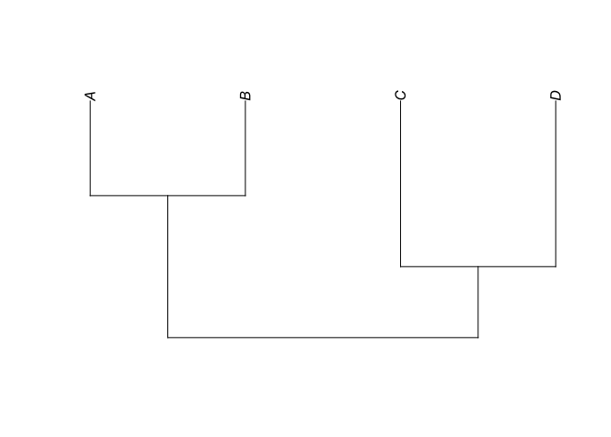

* TOC
{:toc}

Source:
[treepplr-example.qmd](https://github.com/foersterst/foersterst.github.io/blob/master/pages/code/treepplr-example.qmd)

This vignette covers:

1.  [Diversification models (CRBD)](#diversification-models-crbd)
2.  [Tree inference (pruning)](#tree-inference-pruning)
3.  [Host-repertoire (subroot)](#host-repertoire-subroot)
4.  [Qualitative trait evolution](#qualitative-trait-evolution)

> Make sure you’re using treepplr from my branch `improvements`.

I’ve been reworking treepplr to make it faster, easier to use, and less
redundant. Along the way I reorganized the code so it’s easier to
maintain, and fixed a few bugs. This vignette shows how to convert R
objects (lists, data frames, phylo objects, etc.) into TreePPL input
files, and how to convert TreePPL output back into R. I’ll explain the
new and updated functions as they come up.

The core workflow in treepplr is:

**R objects** → `tp_data()` + `tp_sampler()` → `tp_run()` → **R
objects**

``` r
library(devtools)
library(ape)

load_all()
```

## Diversification models (CRBD)

CRBD, ClaDS2, and BDD2 models are all fitted the same way, so I’ll use
CRBD as the example here. You can check the correct spelling of each
model name with `tp_model_library()`, which has a new look:

``` r
tp_model_library()
```

    ── diversification ──

    • bdd2

    • bdd2_delayed

    • clads2

    • clads2_delayed

    • crbd

    • crbd_analytical

    • crbd_delayed

    ── host-repertoire-evolution ──

      • flat-root-prior-HRM

      • subroot-HRM

    ── lang ──

      • anonymous

      • blub

      • coin

      • distributions

      • externals

      • hello

      • matrix-tests

      • mini-mat-test

      • poly

      • ser-list

      • tensors

    ── metabarcoding ──

      • optmodel

    ── pheno-mol ──

      • qt

    ── tree-inference ──

      • substmodel_belief_propagation

      • tree_inference

      • tree_inference_pruning

      • tree_inference_pruning_gtr

      • tree_inference_pruning_gtr_gamma

      • tree_inference_pruning_scaled

For this example, I’m gonna use a toy tree with four tips and height =
10:

``` r
phy <- read.tree(text = "((A:4,B:4):6,(C:7,D:7):3);")

plot.phylo(phy, direction = "upwards")
```



``` r
# tree height
max(node.depth.edgelength(phy))
```

    [1] 10

``` r
class(phy)
```

    [1] "phylo"

We need to create a named list with the input items required by the CRBD
model. Each element of the list must be named exactly like an argument
of the model; the order doesn’t matter. To see the exact names, we use
the new function `tp_expected_input()`:

``` r
tp_expected_input(tppl = "crbd")
```

    ── Expected Input ──

    Model file:
    '/tmp/treeppl-0.4/6yjjihgyj569rg7bw7jkqxy3z1-treeppl-0.4/lib/mcore/treeppl/models/diversification/crbd.tppl'

    Model name: crbd

    Expected arguments:

    • tree (tpPhylo)

    • rho (numeric)

The CRBD expects two arguments: `tree` and `rho`, and these are the
names we have provide to the items in our list. `rho` is a numeric
object and `tree` is a tpPhylo object that is specific to treepplr. We
create the tpPhylo object from an `ape::phylo` object using
`tp_phylo_to_tpPhylo()`:

``` r
phy_2 <- tp_phylo_to_tpPhylo(phy = phy)

# tpPhylo objects have a printing method similar to ape::phylo:
phy_2
```

    Phylogenetic tree of class <tpPhylo>, with 4 tips and 3 internal nodes.

    Rooted; includes branch lengths; root age = 10

> We’ll see later that some models require trees with extra information
> at the leaves and internal nodes. Function `tp_phylo_to_tpPhylo()`
> allows such trees to be created by using the arguments `leaf_extra`
> and `node_extra`. If needed, it is also possible to change the labels
> for node and leaf constructors using the arguments `node_ctor` and
> `leaf_ctor`, respectively.

Now, we create our named list with the data required by our model:

``` r
L <- list(tree = phy_2, rho = 0.35)
```

Next, we call `tp_data()` to assemble the JSON file required by TreePPL
from the R objects we provided:

``` r
data_crbd <- tp_data(model = "crbd", data = L, check = TRUE, print = FALSE)
```

    ── Input Check ──

    JSON file:
    '/private/var/folders/vh/0rc0zn655lsd4yxfvkgdk1hr0000gp/T/Rtmp29hLR9//input-crbd-4d708a5.json'

    Model name: crbd

    ✔ All 2 arguments found: `tree` and `rho`.

`tp_data()` has two new arguments, `check` and `print`. When
`check = TRUE`, the function calls the new function `tp_input_check()`,
which reads the `model function` signature of the specified model and
compares the argument names with the top-level field names in the JSON
input file. It reports missing and extra fields. It only checks names,
not types. `data_crbd` is an object of class `tpData`, which has its own
printing method, controlled by the argument `print`:

``` r
class(data_crbd)
```

    [1] "tpData"

``` r
data_crbd
```

    ── Data Input ──

    Data file:
    '/private/var/folders/vh/0rc0zn655lsd4yxfvkgdk1hr0000gp/T/Rtmp29hLR9//input-crbd-4d708a5.json'

    Model: "crbd"

    Arguments: tree (tpPhylo) and rho (numeric)

With the data ready, we can build the sampler:

``` r
crbd_sampler <- tp_sampler(model = "crbd", method = "smc-apf")
```

    ── TreePPL Sampler ──

    Model file:
    '/tmp/treeppl-0.4/6yjjihgyj569rg7bw7jkqxy3z1-treeppl-0.4/lib/mcore/treeppl/models/diversification/crbd.tppl'

    Compile options: method = smc-apf

We are using SMC for this example. If you want to pass further arguments
to the sampler so that they can be used by TreePPL, you can do so using
the dots (`...`) argument in `tp_sampler()`. For instance, if we wanted
to use `—-subsample` in a MCMC analysis, we would do:

``` r
crbd_mcmc <- tp_sampler(
  model = "crbd",
  method = "mcmc",
  incremental_printing = TRUE
)
```

    ── TreePPL Sampler ──

    Model file:
    '/tmp/treeppl-0.4/6yjjihgyj569rg7bw7jkqxy3z1-treeppl-0.4/lib/mcore/treeppl/models/diversification/crbd.tppl'

    Compile options: method = mcmc and incremental_printing = TRUE

To see all arguments that can be passed to a sampler in TreePPL:

``` r
tp_treeppl_options(what = "compile")
```

    ── Compile options ─────────────────────────────────────────────────────────────

    output = <character>: The name of the final compiled executable. Default: out

    extract_simplification = <character>: Temporary flag that decides the
    simplification approach after extraction in the MExpr compiler backend. The
    supported options are: none, inline, and peval. Default: none. Eventually, we
    will remove this option and only use peval.

    static_delay = <logical>: The model is transformed to an efficient
    representation if possible.

    cps = <character>: Configuration of CPS transformation. The supported options
    are: none, partial, and full. Default: full

    dynamic_delay = <logical>: Runs dynamic delayed sampling on the model.

    prune = <logical>: The model is pruned if possible.

    resample = <character>: The selected resample placement method, for inference
    algorithms where applicable. The supported methods are: likelihood (resample
    immediately after all likelihood updates), align (resample after aligned
    likelihood updates, forces --align), and manual (sample only at manually
    defined resampling locations). Default: likelihood

    pigeons = <logical>: Let Pigeons.jl control inference via stdio.

    incremental_printing = <logical>: Enable printing each sample as it is produced
    instead of at the end.

    kernel = <logical>: Use drift kernels in MCMC.

    drift = <numeric>: Standard deviation of the automatic drift kernels. Default:
    0.1

    align = <logical>: Whether or not to align the model for certain inference
    algorithms.

In terms of data, we have all we need to run our CRBD model. We can then
proceed to call `tp_run()`, which takes the data we have just prepared
and some other runtime information:

``` r
# uisng the SMC sampler:
crbd_smc_res <- tp_run(
  sampler = crbd_sampler,
  data = data_crbd,
  sweeps = 2,
  particles = 15
)
```

    ── Analysis Summary ──

    ✔ Completed

    Elapsed time: 0.96 secs

    Model: crbd

    Method: smc-apf

    Output directory:
    "/private/var/folders/vh/0rc0zn655lsd4yxfvkgdk1hr0000gp/T/Rtmp29hLR9/"

    Output file(s): "out.json"

``` r
# uisng the MCMC sampler:
crbd_mcmc_res <- tp_run(
  sampler = crbd_mcmc,
  data = data_crbd,
  n_runs = 2,
  iterations = 15
)
```

    ── Analysis Summary ──

    ✔ Completed

    Elapsed time: 1.78 secs

    Model: crbd

    Method: mcmc

    Output directory:
    "/private/var/folders/vh/0rc0zn655lsd4yxfvkgdk1hr0000gp/T/Rtmp29hLR9/"

    Output file(s): "out1.json" and "out2.json"

To see all runtime options that can be passed to TreePPL:

``` r
tp_treeppl_options(what = "runtime")
```

    ── Runtime options ─────────────────────────────────────────────────────────────

    seed = <integer>: The starting seed to use. Default: random

    sweeps = <integer>: The number of independent runs of the base algorithm.
    Default: 1

    particles = <integer>: The number of particles in smc. Default: 1000

    no_early_stop = <logical>: Disable early stopping in certain inference
    algorithms.

    subsample = <logical>: Enable subsampling of the posterior distribution.

    subsample_size = <integer>: The number of subsamples to draw if --subsample is
    selected. Default: 1

    max_propagations = <integer>: The maximum number of attempts tried by smc-apf
    (at a given resample step) to find a non-zero weighted path for a particle.
    Default: 1000

    resample_frac = <numeric>: Floating point number to trigger resampling for
    SMC-BPF when ESS is less than resampleFrac × particleCount. Default: 0.7

    no_pigeons_global = <logical>: Disable using global moves when sampling at
    temperature 0.0

    pigeons_explore_steps = <integer>: The number of local MCMC steps to take
    before communicating with Pigeons.jl. Default: 1

    sampling_period = <integer>: Sample the mcmc-chain every Nth iteration.
    Default: 1

    iterations = <integer>: The number of iterations in mcmc. Default: 10000

    mcmc_global_prob = <numeric>: The probability of performing a global MH step
    (non-global means only modify a single sample in the previous trace). Default:
    0.1

    data_augmentation = <integer>: Use the data augmentation algorithm, cycling N
    times before a full redraw. Default: 0

To use, let’s say, `subsample` for SMC, we’d do:

``` r
crbd_smc_res_sub <- tp_run(
  sampler = crbd_sampler,
  data = data_crbd,
  sweeps = 2,
  particles = 20,
  subsample = TRUE,
  subsample_size = 2
)
```

    ── Analysis Summary ──

    ✔ Completed

    Elapsed time: 0.64 secs

    Model: crbd

    Method: smc-apf

    Output directory:
    "/private/var/folders/vh/0rc0zn655lsd4yxfvkgdk1hr0000gp/T/Rtmp29hLR9/"

    Output file(s): "out.json"

`tp_run()` calls `tp_parse_scm()`, `tp_parse_mcmc()`, or
`tp_summarise_trees()` internally, based on the chosen model and
inference method. `tp_parse_smc()`&`tp_parse_mcmc()` read the body of
the `model function` within the `.tppl` file (the `.tppl` file is
automatically passed to the parsers by `tp_run()`) to find its `return`
statement, which gives the output columns their names. If the model
returns a record with named fields (e.g.,
`return ReturnType { lambda = lambda, mu = mu }`), the names are already
in the output and are used as they are.

For the CRBD model, the output of TreePPL is parsed to tidy data frames:

``` r
# plain SMC
crbd_smc_res
```

    # A tibble: 28 × 7
       sweep particle log_weight norm_constant norm_weight lambda    mu
       <int>    <int>      <dbl>         <dbl>       <dbl>  <dbl> <dbl>
     1     1        1      -2.66         -16.5       0.193  0.680 0.604
     2     1        2      -2.66         -16.5       0.193  0.680 0.604
     3     1        3      -2.66         -16.5       0.193  0.680 0.604
     4     1        4      -2.66         -16.5       0.193  0.680 0.604
     5     1        5      -2.66         -16.5       0.193  0.680 0.604
     6     1        6      -2.66         -16.5       0.193  0.680 0.604
     7     1        7      -2.66         -16.5       0.193  0.680 0.604
     8     1        8      -2.66         -16.5       0.193  0.680 0.604
     9     1        9      -2.66         -16.5       0.193  0.680 0.604
    10     1       11      -2.66         -16.5       0.193  0.680 0.604
    # ℹ 18 more rows

``` r
table(crbd_smc_res$sweep)
```

     1  2 
    14 14 

``` r
# SMC sith subsample
crbd_smc_res_sub
```

    # A tibble: 4 × 7
      sweep particle log_weight norm_constant norm_weight lambda    mu
      <int>    <int>      <dbl>         <dbl>       <dbl>  <dbl> <dbl>
    1     1        1     -0.693         -9.95       1      0.281 0.204
    2     1        2     -0.693         -9.95       1      0.281 0.204
    3     2        1     -0.693        -12.0        0.134  0.520 0.383
    4     2        2     -0.693        -12.0        0.134  0.520 0.383

``` r
table(crbd_smc_res_sub$sweep)
```

    1 2 
    2 2 

``` r
# MCMC with incremental printing
crbd_mcmc_res
```

    # A tibble: 32 × 4
         run iteration lambda    mu
       <int>     <int>  <dbl> <dbl>
     1     1         1  0.109 0.102
     2     1         2  0.109 0.102
     3     1         3  0.109 0.102
     4     1         4  0.109 0.102
     5     1         5  0.109 0.102
     6     1         6  0.109 0.102
     7     1         7  0.109 0.102
     8     1         8  0.109 0.102
     9     1         9  0.109 0.102
    10     1        10  0.109 0.102
    # ℹ 22 more rows

``` r
table(crbd_mcmc_res$run)
```

     1  2 
    16 16 

## Tree inference (pruning)

## Host-repertoire (subroot)

## Qualitative trait evolution
